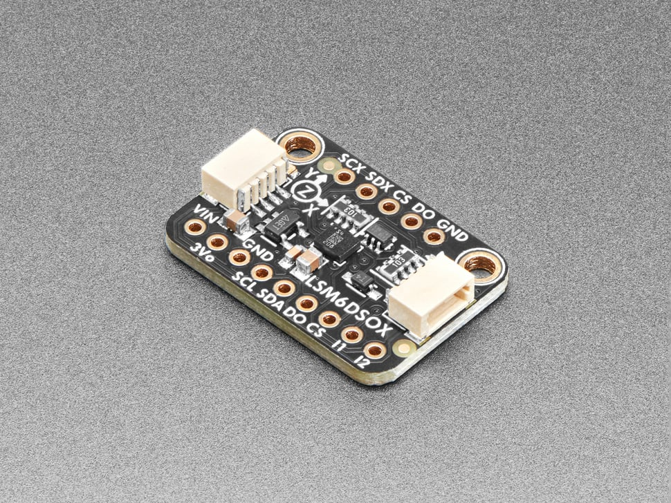
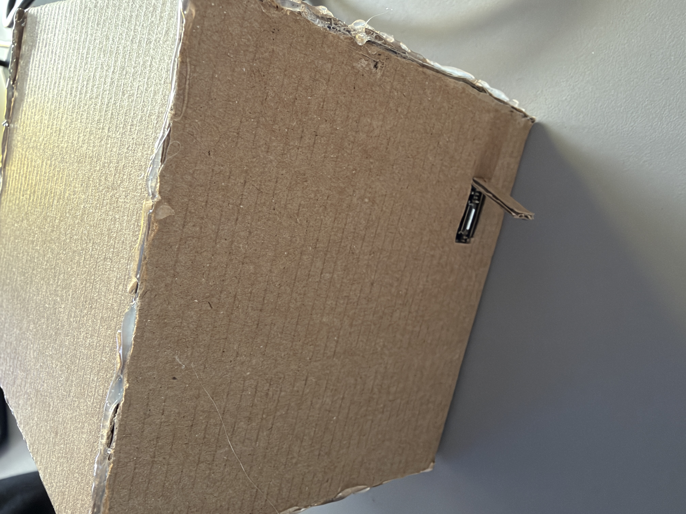

# Evolution of the idea

## Exploring the hardware

Before the project start, hardwares I interested in are Arduino MKR WiFi board I have, and several different types of sensors.
After trying different sensors and boards, I chose the accelerometer from STMicroelectronics.
It provides 6-axis inertial measurement units, including three accelerometers and three gyroscopes, with embedded AI.

During the test of the sensor, I also found that there's a temperature sensor on the back of the board, but it might not be used for conciseness.

## Implementing the idea

The wire connection used I2C wiring, which used less wires and required less connection.
The sensor works on 3.3V voltage so its just matched the Arduino board's operating voltage.

The software implementation was quite simple, including an MQTT server connection, a web client, and other LED controlling logics.

## Box design

The original idea of this project was to make it a ball, but it turned out to be infeasible using cardboards.

The box is a 10\*10\*10cm cube.
It can be more compact but it is basically suitable for holding in hands.

Both the sensor and the board are glued to the bottom of the cardboard box.
The meterial of the box could be better to improve the structural strength.
